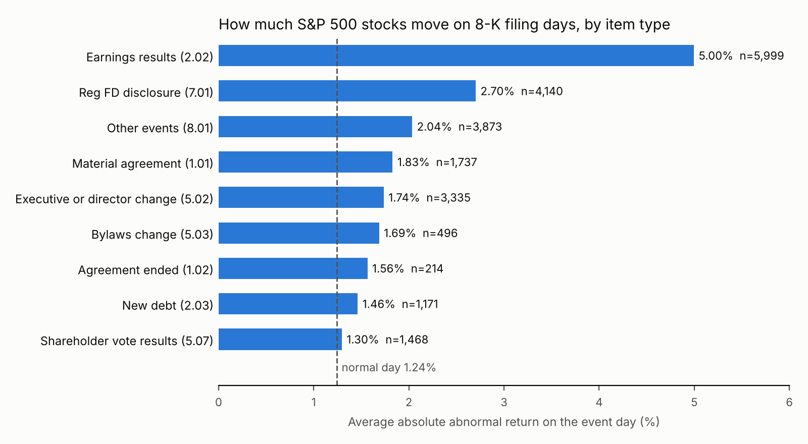

# Market Data Quality Monitor

A pipeline that pulls daily prices for every S&P 500 stock from two free vendors (Yahoo Finance and Nasdaq),
checks each vendor row by row, reconciles the two against each other, builds one clean price table with a
status on every row, and then uses that table for an event study of 17,051 SEC 8-K filings.

It runs on GitHub Actions every week. Raw downloads are kept on the `data` branch exactly as received, so
every cleaning step can be rerun and checked.

## Results (Jan 2023 to Nov 2026, 964 trading days)

### 1. The two vendors agree on 98.2% of days, and almost every disagreement is a spin-off

| | |
|---|---|
| Rows compared (same ticker, same day) | 476,895 across 501 tickers |
| Agree within 0.5% | 468,207 (98.2%) |
| Disagree on price level | 8,688 days in 19 tickers |
| ... of which the daily move still agrees | 8,548 (98.4% of disagreements) |
| Real conflicts (level and daily move both differ) | 140 days |

The disagreements are not noise. 16 of the 19 tickers show a gap that is constant for 100+ days and then
disappears on one date. In 14 of them that date is the session right before Yahoo records a fractional
"split" (MMM 1.196 on the Solventum spin-off, GE 1.281 for GE HealthCare, LH 1.164 for Fortrea, FTV,
WDC, BDX, FDX, SPGI and others). Yahoo scales all earlier prices by a spin-off factor and stores it as a
split. Nasdaq either does not adjust for spin-offs or uses a different factor. The gap within each run has a
standard deviation near 1e-7, so day-to-day returns are identical.

The first version of the pipeline marked all 8,688 days as conflicts and dropped those returns. Comparing
daily moves as well as levels keeps 8,548 of them as `offset` rows, and only 140 real conflicts remain
(119 of them are CRH before its primary listing moved to the NYSE in September 2023).

### 2. Row checks found vendor problems that would quietly break an analysis

| Problem | Vendor | Rows |
|---|---|---|
| High or low that does not contain the open and close, 86 tickers on one day (2023-06-05) | Nasdaq | 87 |
| Pre-listing history with zero volume and a frozen price (SW, before its July 2024 listing) | Yahoo | 198 zero volume, 137 stale |
| Stale price run (CRH before its NYSE listing) | Nasdaq | 92 |
| Half-finished intraday bar picked up when a run happened during market hours | Yahoo | 8 |
| Moves over 25% that are not splits | both | ~90 each, same 56 tickers in both, so real moves |

The intraday bar issue is fixed: the pipeline now only uses sessions that have closed.

### 3. Clean table

Every Yahoo row gets a status: `confirmed` (468,207), `offset` (8,548), `single_source` (2,996),
`conflict` (140) or `rejected`. Returns are computed only where both ends of the move are usable, which
gives 479,200 daily returns.

### 4. Event study on 17,051 8-K filings

Event day is set from the SEC acceptance timestamp. A filing accepted at or after 4pm Eastern counts on the
next trading session. Abnormal return is the stock return minus the equal-weight index return that day.



* On a normal day the average absolute abnormal move is 1.24%. On an 8-K day it is 2.78%.
* Earnings releases (Item 2.02, 5,999 filings) average a 5.00% move, 4.0 times a normal day.
* Controlling for other items filed together (OLS with standard errors clustered by company), a material
  agreement (1.01) adds 0.68 points (95% CI 0.33 to 1.02). New debt (2.03) and shareholder vote results
  (5.07) come with smaller moves than other filings.
* **Press release tone does not predict returns.** I scored 16,960 filings with the Loughran-McDonald
  dictionary (9,131 from the attached press release, the rest from the 8-K form), set tone terciles on the
  earlier 60% of filings, and tested on the later 40%. The top minus bottom tercile spread on the event
  day is -0.13% (95% bootstrap CI -0.42 to 0.14), and the same for earnings releases alone is -0.20%
  (-0.90 to 0.49). A placebo on the five days before each filing looks the same. Simple dictionary tone is
  either priced in at once or too blunt to carry a signal.

## How it works

```
src/fetch.py      download universe, Yahoo (yfinance), Nasdaq (public API), SEC 8-Ks and press releases
src/quality.py    normalize vendors, row checks, adjustment convention per ticker, daily reconciliation, clean table
src/events.py     abnormal returns, event day mapping, event panel, item effects, out of sample tone test
src/run_all.py    runs everything and writes outputs/
tests/            7 tests with planted problems (bad OHLC, stale runs, splits, spin-off offsets, Good Friday filings)
```

Outputs: `outputs/results.json`, `issues.csv`, `vendor_conventions.csv`, `price_mismatches.csv`,
`level_breaks.csv`.

Built with polars, exchange_calendars (NYSE sessions), statsmodels and pysentiment2. SEC requests stay
under 10 per second with a declared user agent.

```
pip install -r requirements.txt
python src/fetch.py      # about 70 minutes, mostly SEC downloads
python src/run_all.py    # about 10 seconds
```
